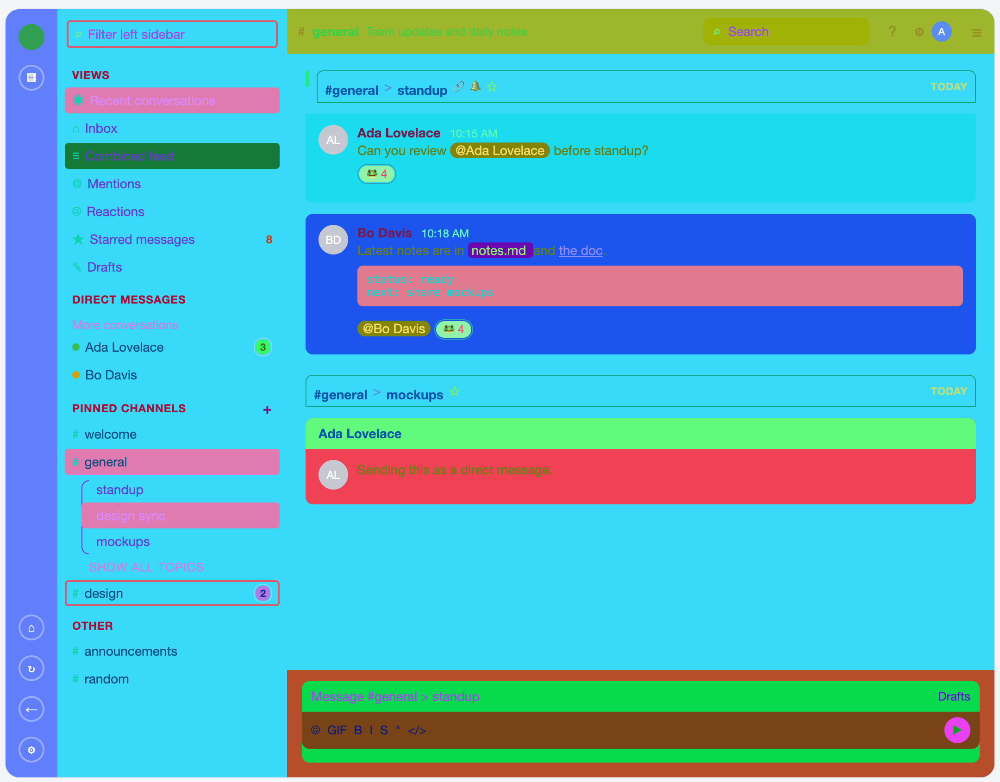

# Zulip Themer

You can change your Zulip theme by going to Zulip menu > Desktop Settings > General > Add custom CSS

To  make your own theme, just use the webtool. There's lots of CSS fields, the tool has every single one of them in it. The "isolate" theme, in themes/isolate.json, if you load it into your Zulip desktop client, has a unique color for every CSS field. That makes it look like puke, BUT it also means that you can use a color picker on any element/screenshot to find what css tag maps to that element. 

You can save your theme out to json if you want to edit it later. Otherwise export it to CSS and import it into your Zulip client.

